<p align="center">
  
</p>

<h1 align="center">Plan Task Gestor</h1>

<p align="center">
  Tareas, hábitos, calendario, proyectos, notas y finanzas personales en una sola app.<br>
  <b>Local-first</b>: tus datos se guardan en tu dispositivo, funciona sin conexión y no necesita cuentas ni servidores.
</p>

<p align="center">
  
  
  
  <br>
  
  
  
  
</p>

<p align="center">
  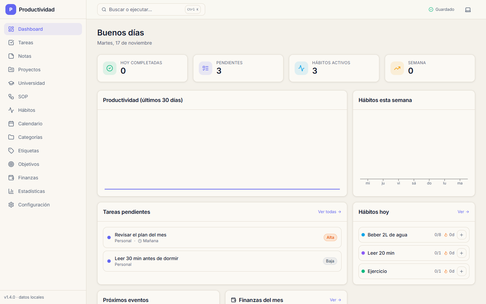
</p>

---

## Índice

1. [Qué es](#qué-es)
2. [Capturas](#capturas)
3. [Funcionalidades](#funcionalidades)
4. [Instalación](#instalación) — [Android](#android-apk) · [Windows](#windows) · [Web](#web)
5. [Actualizaciones](#actualizaciones)
6. [Tus datos](#tus-datos)
7. [Arquitectura y tecnologías](#arquitectura-y-tecnologías)
8. [Para desarrolladores](#para-desarrolladores)
9. [Estructura del repositorio](#estructura-del-repositorio)
10. [Seguridad](#seguridad)
11. [Estado y limitaciones conocidas](#estado-y-limitaciones-conocidas)

---

## Qué es

Plan Task Gestor es una aplicación de **productividad personal** que reúne en
un mismo lugar lo que normalmente está repartido entre varias apps: lista de
tareas, seguimiento de hábitos, calendario, proyectos con etapas, notas,
objetivos y finanzas personales.

**Para quién:** personas que quieren organizar su trabajo, sus estudios y su
vida personal sin depender de una cuenta en la nube.

**Qué la diferencia de una lista de tareas:**

- Los módulos están **conectados**: las tareas alimentan objetivos y
  estadísticas, los hábitos y las tareas aparecen en el calendario, las metas
  de ahorro se reflejan en los objetivos.
- Es **local-first**: no hay registro, servidor ni telemetría. Todo funciona
  sin Internet y los datos no salen del dispositivo salvo que tú exportes una
  copia de seguridad.
- La **misma app** se instala en Windows (Tauri), en Android (APK) y se usa
  desde el navegador (PWA).

---

## Capturas

Capturas reales del build de producción con los **datos de ejemplo** que la
app crea en una instalación nueva (sin datos personales).

### Escritorio

| Tareas (lista, Kanban e historial) | Calendario |
| :---: | :---: |
| 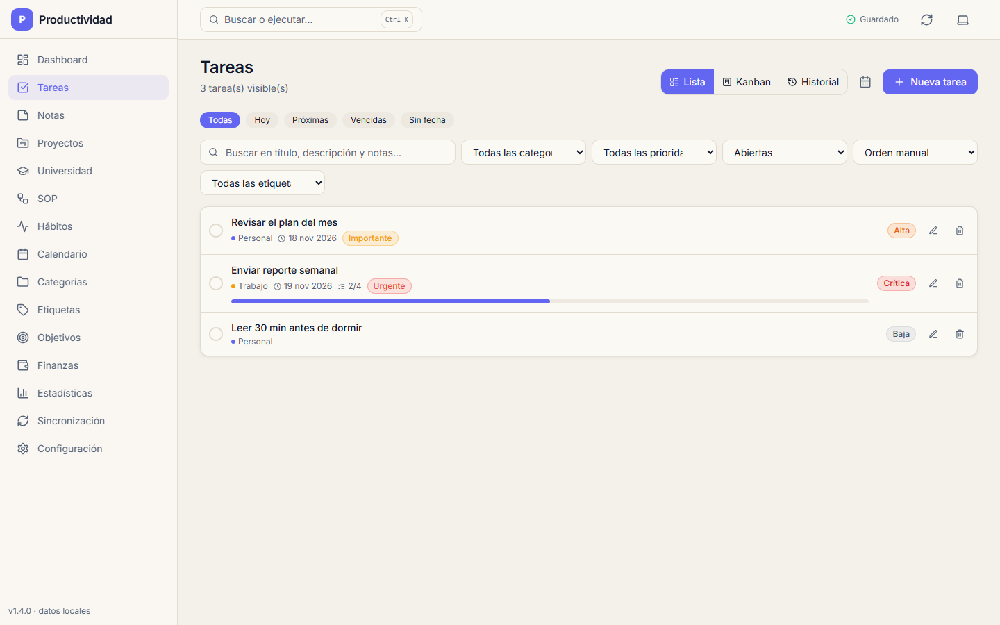 | 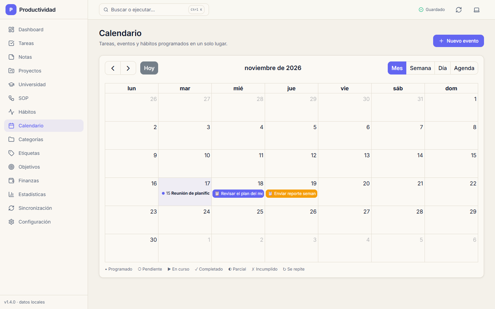 |
| **Proyectos (profesional y personal)** | **Hábitos** |
| 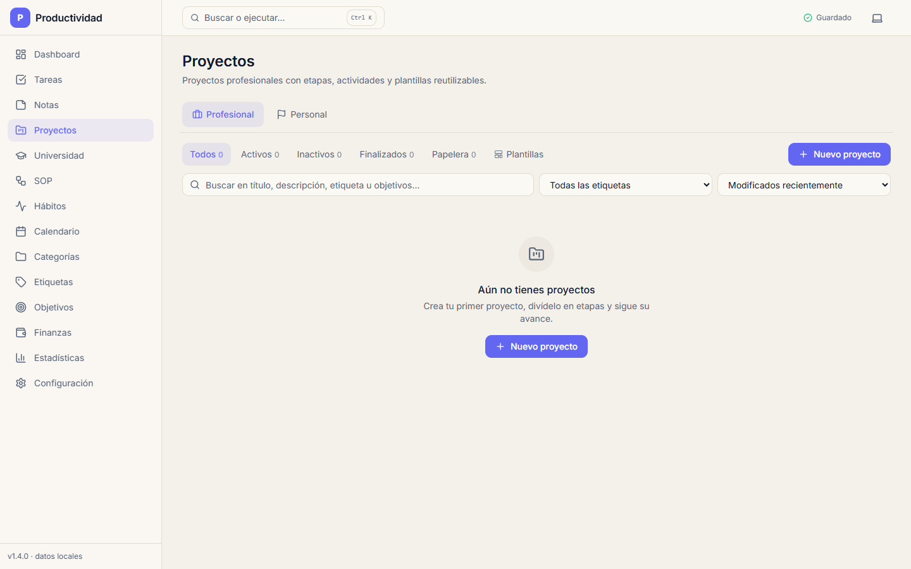 | 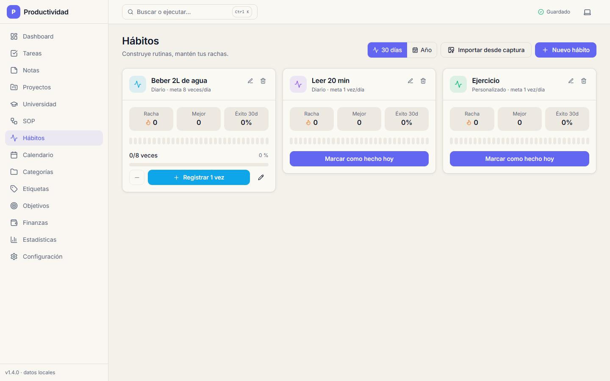 |
| **Finanzas** | **Copias de seguridad** |
| 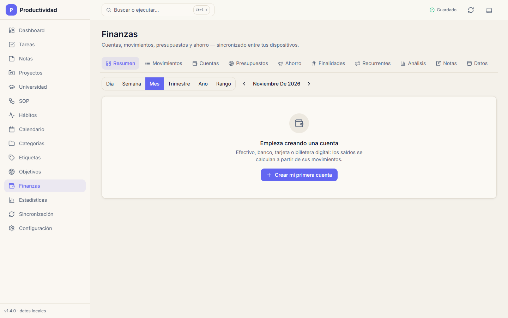 | 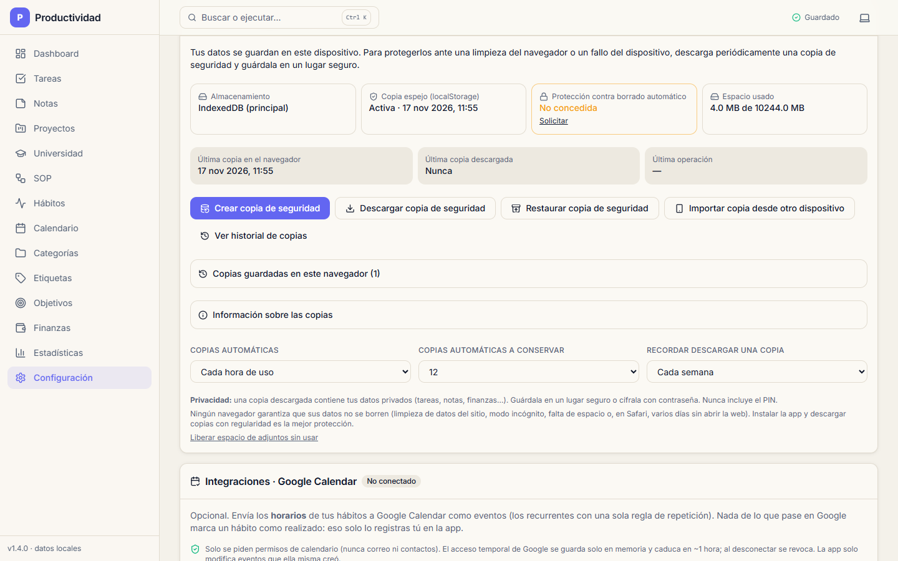 |

La barra lateral de la izquierda es el **panel de navegación** de escritorio;
en el móvil se convierte en una barra inferior con las secciones principales
y un menú «Más».

### Android

APK de release instalado en un emulador Pixel con Android 14. La barra
inferior sustituye al panel lateral y respeta los botones del sistema.

| Panel principal | Tareas | Proyectos | Notas |
| :---: | :---: | :---: | :---: |
| 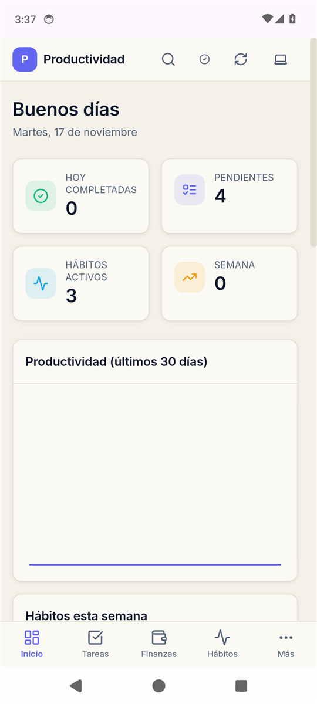 | 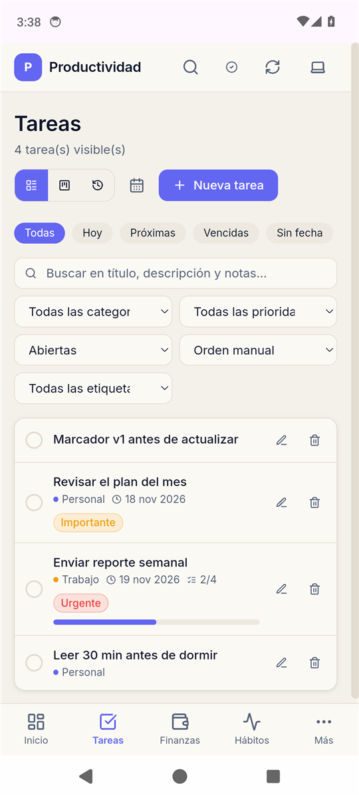 | 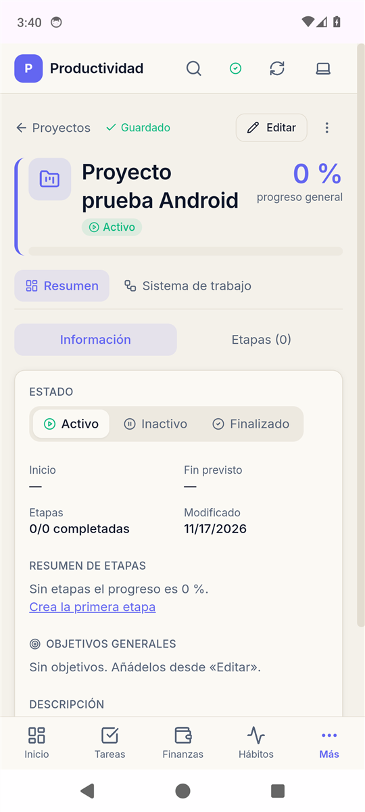 | 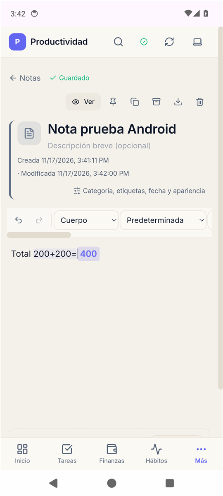 |

---

## Funcionalidades

Todos los módulos de esta tabla están **implementados** y disponibles en las
tres plataformas, salvo donde se indica.

| Módulo | Qué permite |
| :--- | :--- |
| **Panel principal** | Resumen del día: tareas pendientes y completadas, hábitos de hoy, próximos eventos, finanzas del mes y progreso de objetivos. |
| **Tareas** | Vistas de lista, Kanban (arrastrar y soltar) e historial. Filtros rápidos (Hoy, Próximas, Vencidas, Sin fecha), prioridades, categorías, etiquetas, subtareas, tareas recurrentes y recordatorios. |
| **Calendario** | Vistas de mes, semana, día y agenda que unifican eventos, tareas con fecha y horarios de hábitos. |
| **Hábitos** | Frecuencia diaria o por días, metas cuantificables (p. ej. 8 vasos), rachas, mapa de calor anual e importación desde una captura de calendario con OCR local. |
| **Proyectos** | Proyectos profesionales con etapas, objetivos, progreso calculado y plantillas reutilizables; proyectos personales (metas) con línea del tiempo. Se pueden mover entre ambos tipos sin perder datos. |
| **Universidad** | Semestres, materias, horario y entregas. |
| **SOP** | Procedimientos operativos estándar y plantillas de procesos reutilizables. |
| **Objetivos** | Metas diarias, semanales, mensuales o anuales con progreso manual, desde tareas vinculadas o desde una meta de ahorro. |
| **Notas** | Editor de texto enriquecido, categorías, adjuntos, papelera, autoguardado y cálculos automáticos (`200+200=` → `400`). |
| **Finanzas** | Cuentas, movimientos, transferencias, presupuestos, metas de ahorro, finalidades, recurrentes, análisis, notas financieras e importación de CSV, Excel, JSON, SQL, SQLite y Cashew. |
| **Estadísticas** | Gráficos de tareas por prioridad, hábitos en el tiempo e índices de productividad. |
| **Categorías y etiquetas** | Organización jerárquica con color e icono, y etiquetas globales. |
| **Copias de seguridad** | En *Configuración › Copias de seguridad*: crear y **exportar** una copia completa (opcionalmente cifrada), **importar** o restaurar una copia (también la de otro dispositivo) con un asistente que muestra su contenido antes de aplicarla, y lista de las **copias encontradas** en la app (automáticas y manuales) para restaurarlas, descargarlas o borrarlas. |
| **Configuración** | Tema claro/oscuro, apariencias, color de acento, tamaño de letra, bloqueo por PIN, recordatorios y paleta de comandos (`Ctrl+K`). |
| **Google Calendar** | Sincronización de hábitos con Google Calendar. **Solo en la versión web**: Google no permite su inicio de sesión dentro de la app instalada. |

---

## Instalación

### Android (APK)

| Dato | Valor |
| :--- | :--- |
| Versión | 1.4.0 (`versionCode` 1004000) |
| Android mínimo | 7.0 (API 24), declarado en el APK; probado en un emulador con Android 14 (API 34) |
| Arquitecturas | arm64-v8a, armeabi-v7a, x86, x86_64 (APK universal) |
| Tamaño | 61,2 MiB (64,2 MB) |
| Firma | Firmado con la clave de release del proyecto (APK Signature Scheme v2) |
| Identificador | `com.alejandrodukesini.gestortareas` |
| Permisos | Internet (no se usa para tus datos) y notificaciones (se piden al activar los recordatorios) |
| Descarga | **Todavía no hay un APK publicado.** Cuando se publique, estará en [GitHub Releases](https://github.com/AlejandroDukesini/Personal_Task_Gestor/releases). |

**Instalar:**

1. Descarga el archivo `.apk` desde la página de Releases del proyecto.
2. Ábrelo en el teléfono (desde *Archivos* o la notificación de descarga).
3. Si Android lo pide, permite **«Instalar apps desconocidas»** solo para la
   app desde la que lo abriste (navegador o *Archivos*).
4. Pulsa **Instalar**. Si Play Protect avisa de que la app es desconocida
   (no viene de Play Store), elige *Más detalles › Instalar de todas formas*.
5. Abre **Plan Task Gestor** desde el cajón de aplicaciones.

**Actualizar:** instala el APK nuevo **encima** del anterior, sin desinstalar:
tus datos se conservan. Android solo acepta la actualización si el APK nuevo
tiene **el mismo identificador y la misma clave de firma**, y un número de
versión mayor.

> Desinstalar la app borra sus datos. Antes de desinstalar o cambiar de
> teléfono, exporta una copia en *Configuración › Copias de seguridad*.

### Windows

| Dato | Valor |
| :--- | :--- |
| Versión | 1.4.0 |
| Sistema | Windows 10/11 de 64 bits (x64) |
| Formato | Instalador NSIS (`.exe`), por usuario, sin permisos de administrador |
| Tamaño | 11,6 MiB (instalador online; descarga WebView2 solo si falta). Existe una variante offline que incluye WebView2. |
| Firma | **Sin firmar**: Windows SmartScreen puede mostrar «Windows protegió su PC» |
| Descarga | **Todavía no hay instaladores publicados para la 1.4.0.** Las releases existentes ([`v1.1.0 BETA`](https://github.com/AlejandroDukesini/Personal_Task_Gestor/releases)) no incluyen archivos. Se publicarán en [GitHub Releases](https://github.com/AlejandroDukesini/Personal_Task_Gestor/releases) (ver [Publicar una versión](#publicar-una-versión)). |

**Instalar:**

1. Descarga `PlanTaskGestor_<versión>_x64-setup.exe` desde Releases.
2. Haz doble clic sobre él. Si aparece «Windows protegió su PC», pulsa
   **Más información › Ejecutar de todas formas** (pasa porque el instalador
   aún no tiene firma de código).
3. Sigue el asistente: *Siguiente › Instalar › Finalizar*.
4. Abre **Plan Task Gestor** desde el menú Inicio o el acceso directo. La
   ventana se abre maximizada.

**Verificar la descarga (opcional):** cada release incluye `SHA256SUMS.txt`
y una atestación de procedencia de GitHub.

```powershell
Get-FileHash .\PlanTaskGestor_<versión>_x64-setup.exe        # compárala con SHA256SUMS.txt
gh attestation verify PlanTaskGestor_<versión>_x64-setup.exe -R AlejandroDukesini/Personal_Task_Gestor
```

**Desinstalar:** *Configuración de Windows › Aplicaciones › Plan Task Gestor ›
Desinstalar*. Si no marcas la casilla de borrar datos, se conservan en
`%LOCALAPPDATA%\com.alejandrodukesini.gestortareas` y una reinstalación los
vuelve a ver.

> **Si tenías la app con su nombre anterior, «Plan Gestor Task»:** el
> instalador nuevo se instala aparte y **ve los mismos datos**. Puedes
> desinstalar la entrada antigua, pero **no marques la casilla de borrar
> datos**: es la misma carpeta que usa la app nueva.

### Web

La versión web está publicada en **[task-gestor.netlify.app](https://task-gestor.netlify.app/)**.
Funciona en cualquier navegador actual y se puede instalar como app (PWA)
desde el menú del navegador. Sus datos son independientes de los de las apps
de Windows y Android.

---

## Actualizaciones

| Plataforma | Cómo se actualiza |
| :--- | :--- |
| Android | Manualmente: instalando el APK de la versión nueva encima del actual (misma clave de firma). |
| Windows | Manualmente: ejecutando el instalador de la versión nueva encima del actual. |
| Web / PWA | Automáticamente: al publicar una versión, la app muestra un aviso para recargar. |

**La app instalada no se actualiza sola** (no incluye actualizador automático)
y no está publicada en Google Play ni en Microsoft Store.

---

## Tus datos

- Se guardan **solo en el dispositivo**: IndexedDB de la WebView como
  almacenamiento principal, una copia espejo en `localStorage` y puntos de
  restauración automáticos.
- Sobreviven a cerrar la app, reiniciar y actualizar.
- Cada plataforma tiene **sus propios datos** y no hay sincronización entre
  dispositivos. Para pasarlos de uno a otro: exporta una **copia de
  seguridad** en el primero e impórtala en el segundo.
- Haz copias periódicas (*Configuración › Copias de seguridad*): son la única
  protección frente a una desinstalación o la pérdida del dispositivo.

---

## Arquitectura y tecnologías

```text
┌──────────────────────── Interfaz (React + Vite) ────────────────────────┐
│  páginas y componentes  →  services/api.ts  →  services/localApi.ts     │
│                                    (rutas REST resueltas en local)       │
│                                              ↓                           │
│                 services/storage.ts: IndexedDB + espejo + restauración   │
└──────────────────────────────────────────────────────────────────────────┘
        Web (PWA)          Windows: Tauri 2 + WebView2      Android: Tauri 2 + WebView
```

- **Sin backend:** las páginas llaman a una API con forma REST que se resuelve
  dentro de la propia app (`localApi.ts`), sobre el almacenamiento local.
- **Sin Internet:** todo funciona sin conexión. Solo usan red, si los
  activas, Google Calendar (web) y los enlaces externos.
- **Windows y Android** empaquetan el mismo build de Vite con Tauri 2. El
  código nativo es mínimo: abre enlaces en el navegador del sistema, lanza
  notificaciones y, en Android, guarda archivos con el selector del sistema
  (la WebView de Android no permite descargas directas).

| Capa | Tecnología (versión instalada) |
| :--- | :--- |
| Interfaz | React 18.3.1, TypeScript 5.9.3, Vite 6.4.5, Tailwind CSS 3.4.19, React Router 7.18.4, Zustand 5.0.16, Framer Motion 11.18.2 |
| Componentes | FullCalendar 6.1.22, Tiptap 3.32.0 (editor de notas), Recharts 2.15.4 (gráficos), Tesseract.js 7.0.0 (OCR local) |
| Validación | Zod 4.6.7 |
| Persistencia | IndexedDB + `localStorage` (sin SQLite: el volcado SQL de finanzas es solo exportación) |
| Apps nativas | Tauri 2.12.5 (CLI 2.12.4), Rust estable; plugins `opener`, `notification` y, en Android, `dialog` + `fs` |
| Android | Gradle 9.6.1, Android Gradle Plugin 9.3.1, Kotlin 2.2.10, compileSdk/targetSdk 37, minSdk 24, NDK 29 |
| Pruebas | Vitest 4.1.12 con happy-dom y fake-indexeddb |

---

## Para desarrolladores

### Requisitos

- **Node.js 24** (fijado en `.nvmrc`) y npm.
- **Windows:** Rust estable (`stable-x86_64-pc-windows-msvc`) y Visual Studio
  Build Tools 2022 con «Desarrollo de escritorio con C++».
- **Android:** además, Android SDK, NDK 29, JDK 21 y los targets de Rust para
  Android. Paso a paso en **[`docs/ANDROID_BUILD.md`](docs/ANDROID_BUILD.md)**.

### Instalar y ejecutar

```bash
git clone https://github.com/AlejandroDukesini/Personal_Task_Gestor.git
cd Personal_Task_Gestor
npm ci            # dependencias exactas del package-lock
npm run dev       # app web en http://localhost:5173 (sin backend ni base de datos)
```

### Comandos

| Comando | Qué hace |
| :--- | :--- |
| `npm run dev` | Servidor de desarrollo (Vite). |
| `npm run build` | Comprueba tipos (`tsc`) y genera el build de producción en `client/dist`. |
| `npm run preview` | Sirve el build de producción en local. |
| `npm test` | Pruebas del cliente (Vitest). |
| `npm run desktop:dev` | App de Windows con recarga en caliente. |
| `npm run desktop:build` | Instalador de Windows online → `client/src-tauri/target/release/bundle/nsis/`. |
| `npm run desktop:build:offline` | Instalador de Windows con WebView2 incluido. |
| `npm run android:dev` | App de Android en un emulador o dispositivo conectado. |
| `npm run android:build` | APK de release firmado → `client/src-tauri/gen/android/app/build/outputs/apk/universal/release/`. |
| `npm run version:check` | Comprueba que la versión coincide en todos los archivos. |
| `npm run version:set -- X.Y.Z` | Cambia la versión en todos los archivos (incluida la insignia de este README). |
| `npm run sql:gen` | Regenera el SQL de referencia del módulo de finanzas. |

### Firma de Android

El APK de release se firma con un keystore que **no está en el
repositorio**: Gradle lo busca en `%USERPROFILE%\.plantaskgestor-keys\keystore.properties`
o en la ruta de la variable `PLANTASK_KEYSTORE_PROPERTIES`. Todas las
versiones futuras deben firmarse **con la misma clave**; si se pierde, no se
podrán publicar actualizaciones que se instalen encima. Detalles en
[`docs/ANDROID_BUILD.md`](docs/ANDROID_BUILD.md).

### Publicar una versión

1. `npm run version:set -- X.Y.Z`, `npm test`, `npm run build` y commit.
2. Llevar el commit a `Principal` y esperar a que pase **CI**
   ([`ci.yml`](.github/workflows/ci.yml): pruebas, build e instalador de prueba).
3. Crear y subir el tag: `git tag -a vX.Y.Z -m "Versión X.Y.Z" && git push origin vX.Y.Z`.
4. [`release.yml`](.github/workflows/release.yml) compila los instaladores de
   Windows (online y offline), genera `SHA256SUMS.txt` y la atestación, y crea
   la release. Nunca sobrescribe una release existente.
5. **El APK no se compila en CI** (la clave de firma no está en GitHub): hay
   que generarlo en local con `npm run android:build` y adjuntarlo a la
   release a mano (`gh release upload vX.Y.Z <apk>`).

---

## Estructura del repositorio

```text
Personal_Task_Gestor/
├── README.md                  # este documento
├── package.json               # workspaces (client, server) y scripts
├── netlify.toml               # despliegue de la versión web y cabeceras de seguridad
├── .github/workflows/         # CI y publicación de releases
├── scripts/version.mjs        # versión única en todos los archivos
├── docs/
│   ├── ANDROID_BUILD.md       # compilación y firma del APK
│   └── assets/screenshots/    # capturas de este README
├── client/                    # la aplicación
│   ├── src/                   # React: pages, components, services, store, hooks, lib
│   ├── public/                # iconos, manifest de la PWA y service worker
│   └── src-tauri/             # contenedor nativo (Rust, Tauri)
│       ├── src/               # lib.rs / main.rs
│       ├── capabilities/      # permisos (comunes y solo Android)
│       ├── icons/
│       ├── gen/android/       # proyecto Android (Gradle)
│       ├── tauri.conf.json    # configuración común + Windows
│       └── tauri.android.conf.json
└── server/                    # backend Express + Prisma heredado (la app no lo usa);
                               # conserva las migraciones SQL de finanzas que validan las pruebas
```

---

## Seguridad

- Sin cuentas, sin servidor y sin telemetría: los datos no salen del
  dispositivo salvo que los exportes.
- Copias de seguridad cifrables con AES-256-GCM
  (clave derivada con PBKDF2-SHA256); la contraseña nunca se guarda.
- Bloqueo opcional por PIN.
- Política de seguridad de contenido (CSP) estricta en las apps nativas y en la web.
- Permisos mínimos en Android: sin acceso a contactos, ubicación, cámara,
  micrófono ni almacenamiento general (los archivos se guardan donde tú
  eliges con el selector del sistema).
- El keystore de Android y sus contraseñas están fuera del repositorio
  (`.gitignore` excluye `*.jks`, `*.keystore` y `keystore.properties`).

---

## Estado y limitaciones conocidas

- **En desarrollo activo** (versión 1.4.0, rama `Beta`).
- No hay instaladores ni APK publicados todavía para la 1.4.0.
- El instalador de Windows **no está firmado** con un certificado de código.
- Los **recordatorios** solo se lanzan con la app abierta: no hay servicio en
  segundo plano.
- **Google Calendar** solo está disponible en la versión web.
- En Android, el botón **Atrás** vuelve a la pantalla anterior; si hay un
  panel abierto (menú «Más», formulario) se cierra junto con ese cambio de
  pantalla, en lugar de cerrarse solo el panel.
- El APK se ha probado en un emulador (Android 14), todavía no en un
  teléfono físico.
- Los **adjuntos de las notas** entran en la copia descargada mientras esté
  marcada «Incluir los archivos adjuntos» (opción activada por defecto).
- El proyecto **no tiene licencia definida** todavía.
